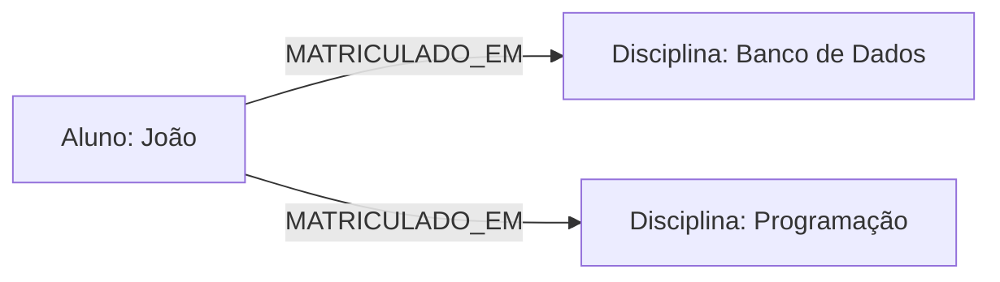

# Aula de Revisão – Neo4j e Apache Cassandra

# PARTE I – NEO4J

## 3. Revisão do Neo4j

O **Neo4j** é um banco de dados NoSQL orientado a grafos.

### 3.1. Principais conceitos

- **Nós (Nodes):** representam entidades.
- **Relacionamentos (Relationships):** representam conexões entre entidades.
- **Propriedades (Properties):** armazenam atributos dos nós e relacionamentos.
- **Labels:** classificam os nós.
- **Cypher:** linguagem de consulta do Neo4j.

### 3.2. Representação de um grafo

Exemplo de relacionamento entre alunos e disciplinas:



### 3.3. Exemplos de comandos Cypher

Criação de nós:

```
CREATE (a:Aluno {
    nome: 'João',
    matricula: 123
});

CREATE (d:Disciplina {
    nome: 'Banco de Dados'
});
```

Criação de relacionamento:

```
MATCH (a:Aluno {matricula: 123}),
      (d:Disciplina {nome: 'Banco de Dados'})

CREATE (a)-[:MATRICULADO_EM]->(d);
```

Consulta:

```
MATCH (a:Aluno)-[:MATRICULADO_EM]->(d:Disciplina)
RETURN a.nome, d.nome;
```

**Questão para discussão:** por que representar alunos e disciplinas como nós conectados pode ser interessante em um sistema acadêmico?

**Resposta esperada:** porque permite representar diretamente os relacionamentos entre entidades e realizar consultas sobre essas conexões. Por exemplo, identificar as disciplinas em que um aluno está matriculado ou encontrar alunos que compartilham disciplinas.

---

# PARTE II – APACHE CASSANDRA

## 4. Introdução ao Apache Cassandra

O **Apache Cassandra** é um banco de dados NoSQL distribuído, baseado em um modelo de armazenamento de colunas largas (*Wide Column Store*).

Foi projetado para trabalhar com grandes volumes de dados, elevada taxa de escrita, disponibilidade e escalabilidade horizontal.

### 4.1. Principais características

- **Distribuído:** os dados ficam armazenados em diferentes nós.
- **Escalabilidade horizontal:** permite adicionar novos servidores ao cluster.
- **Alta disponibilidade:** não depende de um único servidor.
- **Replicação:** mantém cópias dos dados em diferentes nós.
- **Consistência ajustável:** permite configurar o nível de consistência das operações.
- **CQL:** utiliza uma linguagem semelhante ao SQL.

Documentação oficial: [https://cassandra.apache.org/doc/latest/](https://cassandra.apache.org/doc/latest/)

## 5. Arquitetura distribuída

### 5.1. Principais conceitos

| Conceito           | Descrição                                                         |
| ------------------ | ----------------------------------------------------------------- |
| Node               | Servidor que armazena parte dos dados.                            |
| Cluster            | Conjunto de nós Cassandra.                                        |
| Partition          | Conjunto de registros agrupados pela chave de partição.           |
| Replication        | Processo de manter cópias dos dados.                              |
| Replication Factor | Quantidade de réplicas de cada partição.                          |
| Coordinator        | Nó que recebe uma solicitação do cliente e coordena sua execução. |

### 5.2. Arquitetura de um cluster

Imagine um cluster com três servidores:


Ao inserir um registro, Cassandra utiliza a chave de partição para determinar onde os dados serão armazenados. Conforme a estratégia de replicação, outras cópias também serão mantidas.

Uma questão importante: Cassandra não utiliza uma arquitetura tradicional de servidor principal e servidores secundários. Seus nós possuem arquitetura *peer-to-peer*.

### 5.3. Distribuição e replicação

Exemplo conceitual de distribuição de dados:

```
flowchart TD
    I["Inserção de um registro"]
    P["Determinação da Partition Key"]
    D["Distribuição dos dados"]
    N1["Node 1"]
    N2["Node 2"]
    N3["Node 3"]

    I --> P --> D
    D --> N1
    D --> N2
    D --> N3
```

A replicação permite que os dados sejam armazenados em mais de um nó, aumentando a disponibilidade e a tolerância a falhas.

## 6. Estrutura de armazenamento

A hierarquia lógica do Cassandra pode ser representada da seguinte maneira:

```
flowchart TD
    A["Cluster"]
    B["Keyspace"]
    C["Table"]
    D["Partition"]
    E["Rows"]
    F["Columns"]

    A --> B
    B --> C
    C --> D
    D --> E
    E --> F
```

### 6.1. O que é um Keyspace?

O Keyspace é uma estrutura que agrupa tabelas e define configurações de replicação.

Exemplo:

```
CREATE KEYSPACE universidade
WITH replication = {
    'class': 'SimpleStrategy',
    'replication_factor': 1
};
```

Selecionando o Keyspace:

```
USE universidade;
```

> O Replication Factor 1 é adequado apenas para demonstração local. Em ambientes distribuídos, deve-se avaliar NetworkTopologyStrategy e a topologia dos datacenters.

### 6.2. Criação de tabela

```
CREATE TABLE aluno (
    id UUID PRIMARY KEY,
    nome TEXT,
    email TEXT,
    curso TEXT
);
```

Inserção:

```
INSERT INTO aluno (
    id, nome, email, curso
) VALUES (
    uuid(),
    'João Silva',
    'joao@email.com',
    'TADS'
);
```

Consulta:

```
SELECT * FROM aluno;
```

Atualização:

```
UPDATE aluno
SET curso = 'Engenharia de Software'
WHERE id = 123e4567-e89b-12d3-a456-426614174000;
```

Exclusão:

```
DELETE FROM aluno
WHERE id = 123e4567-e89b-12d3-a456-426614174000;
```

## 7. Modelagem de dados no Cassandra

Este é um dos conceitos mais importantes do Cassandra.

No PostgreSQL, normalmente projetamos o banco a partir das entidades e seus relacionamentos.

No Cassandra, a modelagem deve começar pelas consultas que a aplicação precisa realizar.

Isso significa que podemos ter tabelas diferentes armazenando informações semelhantes, mas organizadas para atender consultas específicas.

### 7.1. Primary Key

No Cassandra, a chave primária possui uma função fundamental na distribuição e organização dos dados.

Ela pode ser composta por:

- **Partition Key:** determina a partição onde os dados serão armazenados.
- **Clustering Columns:** determinam a organização dos registros dentro da partição.

Exemplo:

```
CREATE TABLE matricula (
    aluno_id UUID,
    data_matricula TIMESTAMP,
    disciplina TEXT,
    situacao TEXT,
    PRIMARY KEY (aluno_id, data_matricula)
);
```

Nesse exemplo:

- `aluno_id`: Partition Key.
- `data_matricula`: Clustering Column.

Representação:

```
flowchart TD
    A["PRIMARY KEY (aluno_id, data_matricula)"]
    A --> B["Partition Key"]
    A --> C["Clustering Column"]

    B --> D["aluno_id"]
    C --> E["data_matricula"]
```

### 7.2. Como os dados são organizados?

Considerando a tabela anterior:

| aluno_id | data_matricula | disciplina     | situacao |
| -------- | -------------- | -------------- | -------- |
| UUID-1   | 2026-03-01     | Banco de Dados | Aprovado |
| UUID-1   | 2026-03-10     | Programação    | Cursando |
| UUID-1   | 2026-04-01     | Redes          | Cursando |
| UUID-2   | 2026-03-05     | Banco de Dados | Cursando |

Representação conceitual:

```
flowchart TD
    A["Tabela: matricula"]
    A --> P1["Partition: aluno_id = UUID-1"]
    A --> P2["Partition: aluno_id = UUID-2"]

    P1 --> R1["01/03 - Banco de Dados"]
    P1 --> R2["10/03 - Programação"]
    P1 --> R3["01/04 - Redes"]

    P2 --> R4["05/03 - Banco de Dados"]
```

### 7.3. Consultas utilizando a Partition Key

Consulta permitida:

```
SELECT *
FROM matricula
WHERE aluno_id = 123e4567-e89b-12d3-a456-426614174000;
```

Podemos consultar as matrículas de determinado aluno porque fornecemos a Partition Key.

E se tentarmos executar?

```
SELECT *
FROM matricula
WHERE disciplina = 'Banco de Dados';
```

Essa consulta não é permitida por padrão, pois não fornece a Partition Key nem utiliza um índice apropriado.

**Atenção:** Cassandra não deve ser tratado como um PostgreSQL sem JOIN. É necessário pensar nas consultas antes de definir as tabelas.

### 7.4. Clustering Order

Também podemos definir a ordenação dos registros dentro de uma partição.

```
CREATE TABLE acesso (
    usuario_id UUID,
    data_acesso TIMESTAMP,
    ip TEXT,
    recurso TEXT,
    PRIMARY KEY (usuario_id, data_acesso)
) WITH CLUSTERING ORDER BY (
    data_acesso DESC
);
```

Consulta:

```
SELECT *
FROM acesso
WHERE usuario_id = 123e4567-e89b-12d3-a456-426614174000;
```

Os registros serão apresentados do mais recente para o mais antigo.

## 8. Diferenças entre PostgreSQL e Cassandra

| Característica  | PostgreSQL                  | Cassandra                                                 |
| --------------- | --------------------------- | --------------------------------------------------------- |
| Modelo          | Relacional                  | Colunas largas                                            |
| Linguagem       | SQL                         | CQL                                                       |
| Relacionamentos | Foreign Keys                | Não possui FK                                             |
| JOIN            | Suportado                   | Não suportado                                             |
| Transações      | ACID                        | Garantias diferentes, com LWT para operações condicionais |
| Escalabilidade  | Vertical e horizontal       | Horizontal                                                |
| Chave primária  | Identificação e integridade | Identificação, particionamento e ordenação                |

## 9. Outros recursos do Cassandra

### 9.1. Consistência

Cassandra permite configurar o nível de consistência de leitura e escrita.

Alguns níveis:

| Nível  | Descrição                               |
| ------ | --------------------------------------- |
| ONE    | Basta uma réplica responder.            |
| QUORUM | Maioria das réplicas precisa responder. |
| ALL    | Todas as réplicas precisam responder.   |

Exemplo: em um cluster com três réplicas, QUORUM exige duas respostas.

### 9.2. Collections

Cassandra também oferece estruturas para armazenar coleções:

```
CREATE TABLE perfil (
    id UUID PRIMARY KEY,
    nome TEXT,
    telefones SET<TEXT>,
    preferencias MAP<TEXT, TEXT>,
    historico LIST<TEXT>
);
```

Tipos importantes:

- `LIST`: lista de elementos.
- `SET`: conjunto de elementos únicos.
- `MAP`: estrutura de chave e valor.

---

# PARTE III – CASSANDRA COM JAVA

## 10. Integração com Java

Para trabalhar com Cassandra, utilizamos o driver oficial Java.

Ele disponibiliza classes para:

- Estabelecer conexão com o cluster.
- Executar comandos CQL.
- Inserir, atualizar e excluir registros.
- Recuperar resultados.
- Trabalhar com consultas preparadas (*Prepared Statements*).

Documentação: [https://apache.github.io/cassandra-java-driver/4.18.0/core/](https://apache.github.io/cassandra-java-driver/4.18.0/core/)

### 10.1. Dependência Maven

No arquivo `pom.xml`:

```
<dependency>
    <groupId>org.apache.cassandra</groupId>
    <artifactId>java-driver-core</artifactId>
    <version>4.18.0</version>
</dependency>
```

## 11. Estabelecendo conexão

A classe principal para conexão é `CqlSession`.

```
import com.datastax.oss.driver.api.core.CqlSession;

public class Conexao {

    public static void main(String[] args) {

        try (CqlSession session =
                CqlSession.builder().build()) {

            System.out.println(
                "Conectado ao Cassandra!"
            );

        } catch (Exception e) {
            e.printStackTrace();
        }
    }
}
```

Por padrão, o driver procura o Cassandra em `127.0.0.1:9042`.

O objeto `CqlSession` é thread-safe e deve ser reutilizado pela aplicação, em vez de criar uma nova sessão para cada consulta.

## 12. Executando comandos CQL pelo Java

Podemos utilizar o método `execute()`.

Criação de Keyspace:

```
session.execute(
    "CREATE KEYSPACE IF NOT EXISTS universidade " +
    "WITH replication = {'class': " +
    "'SimpleStrategy', 'replication_factor': 1}"
);
```

Criando uma tabela:

```
session.execute("""
    CREATE TABLE IF NOT EXISTS
    universidade.aluno (
        id UUID PRIMARY KEY,
        nome TEXT,
        email TEXT,
        curso TEXT
    )
""");
```

Observe que podemos utilizar blocos de texto com `"""` no Java moderno.

## 13. Inserindo dados com Java

Para trabalhar com identificadores UUID:

```
import java.util.UUID;

UUID id = UUID.randomUUID();

session.execute("""
    INSERT INTO universidade.aluno
    (id, nome, email, curso)
    VALUES (?, ?, ?, ?)
""".formatted(
    id,
    "João Silva",
    "joao@email.com",
    "TADS"
));
```

Esse exemplo demonstra a operação, mas para aplicações reais é preferível utilizar Prepared Statements.

## 14. Prepared Statements

Assim como no JDBC, podemos preparar uma instrução e fornecer os valores posteriormente.

```
import com.datastax.oss.driver.api.core.cql.*;

PreparedStatement ps = session.prepare("""
    INSERT INTO universidade.aluno
    (id, nome, email, curso)
    VALUES (?, ?, ?, ?)
""");

BoundStatement bs = ps.bind(
    UUID.randomUUID(),
    "Maria Souza",
    "maria@email.com",
    "TADS"
);

session.execute(bs);
```

### 14.1. Vantagens

- Reutilização de instruções.
- Separação entre comando e parâmetros.
- Evita concatenar valores diretamente na consulta.
- Melhor aproveitamento do cache de instruções preparadas.

### 14.2. Fluxo de execução

```
flowchart TD
    A["Aplicação Java"]
    B["session.prepare()"]
    C["PreparedStatement"]
    D["ps.bind()"]
    E["BoundStatement"]
    F["session.execute()"]
    G["Cassandra"]

    A --> B --> C --> D --> E --> F --> G
```

## 15. Recuperando dados com Java

```
ResultSet resultado = session.execute("""
    SELECT id, nome, email, curso
    FROM universidade.aluno
""");

for (Row row : resultado) {

    UUID id = row.getUuid("id");

    String nome = row.getString("nome");

    String email = row.getString("email");

    String curso = row.getString("curso");

    System.out.println(
        id + " - " + nome + " - " +
        email + " - " + curso
    );
}
```

### 15.1. Correspondência entre tipos CQL e Java

| Cassandra (CQL) | Java       |
| --------------- | ---------- |
| TEXT            | String     |
| INT             | int        |
| BIGINT          | long       |
| BOOLEAN         | boolean    |
| UUID            | UUID       |
| TIMESTAMP       | Instant    |
| DECIMAL         | BigDecimal |
| LIST            | List       |
| SET             | Set        |
| MAP             | Map        |

## 16. Atualizando e excluindo registros

### UPDATE

```
PreparedStatement ps = session.prepare("""
    UPDATE universidade.aluno
    SET curso = ?
    WHERE id = ?
""");

session.execute(
    ps.bind(
        "Engenharia de Software",
        id
    )
);
```

### DELETE

```
PreparedStatement ps = session.prepare("""
    DELETE FROM universidade.aluno
    WHERE id = ?
""");

session.execute(ps.bind(id));
```

Observe que o `WHERE` utiliza a chave primária, permitindo localizar diretamente a partição correspondente.

## 17. Organizando o acesso ao Cassandra em uma classe DAO

Podemos aplicar o padrão DAO (*Data Access Object*), separando as operações de persistência das demais responsabilidades da aplicação.

Exemplo de organização:

```
src/main/java/
    Conexao.java
    model/
        Aluno.java
    dao/
        AlunoDAO.java
    Main.java
```

### 17.1. Classe Aluno

```
import java.util.UUID;

public class Aluno {

    private UUID id;
    private String nome;
    private String email;
    private String curso;

    public Aluno(String nome, String email, String curso) {
        this.id = UUID.randomUUID();
        this.nome = nome;
        this.email = email;
        this.curso = curso;
    }

    public UUID getId() {
        return id;
    }

    public String getNome() {
        return nome;
    }

    public String getEmail() {
        return email;
    }

    public String getCurso() {
        return curso;
    }
}
```

### 17.2. Classe AlunoDAO

```
import java.util.UUID;

import com.datastax.oss.driver.api.core.CqlSession;
import com.datastax.oss.driver.api.core.cql.*;

public class AlunoDAO {

    private final CqlSession session;

    public AlunoDAO(CqlSession session) {
        this.session = session;
    }

    public void inserir(Aluno aluno) {

        PreparedStatement ps = session.prepare("""
            INSERT INTO universidade.aluno
            (id, nome, email, curso)
            VALUES (?, ?, ?, ?)
        """);

        session.execute(ps.bind(
            aluno.getId(),
            aluno.getNome(),
            aluno.getEmail(),
            aluno.getCurso()
        ));
    }

    public void listar() {

        ResultSet rs = session.execute("""
            SELECT * FROM universidade.aluno
        """);

        for (Row row : rs) {
            System.out.println(
                row.getString("nome") + " - " +
                row.getString("email")
            );
        }
    }

    public void excluir(UUID id) {

        PreparedStatement ps = session.prepare("""
            DELETE FROM universidade.aluno
            WHERE id = ?
        """);

        session.execute(ps.bind(id));
    }
}
```

### 17.3. Classe Main

```
import com.datastax.oss.driver.api.core.CqlSession;

public class Main {

    public static void main(String[] args) {

        try (CqlSession session =
                CqlSession.builder().build()) {

            AlunoDAO dao = new AlunoDAO(session);

            Aluno aluno = new Aluno(
                "João Silva",
                "joao@email.com",
                "TADS"
            );

            dao.inserir(aluno);

            dao.listar();

            dao.excluir(aluno.getId());

        }
    }
}
```

**Conceito importante:** o DAO continua sendo aplicável em bancos NoSQL. O que muda é a implementação da camada de persistência.

---

# PARTE IV – NEO4J COM JAVA

## 18. Integração do Neo4j com Java

O Neo4j também possui um driver oficial para Java, permitindo executar comandos Cypher diretamente pela aplicação.

### 18.1. Dependência Maven

```
<dependency>
    <groupId>org.neo4j.driver</groupId>
    <artifactId>neo4j-java-driver</artifactId>
    <version>6.1.0</version>
</dependency>
```

### 18.2. Exemplo de conexão e execução

```
import org.neo4j.driver.*;

import java.util.Map;

public class Main {

    public static void main(String[] args) {

        String uri = "bolt://localhost:7687";

        String usuario = "neo4j";
        String senha = "12345678";

        try (Driver driver = GraphDatabase.driver(
                uri,
                AuthTokens.basic(usuario, senha))) {

            driver.verifyConnectivity();

            var resultado = driver.executableQuery("""
                CREATE (a:Aluno {
                    nome: $nome,
                    curso: $curso
                })
                RETURN a.nome AS nome
            """)
            .withParameters(Map.of(
                "nome", "João",
                "curso", "TADS"
            ))
            .execute();

            resultado.records().forEach(
                r -> System.out.println(
                    r.get("nome").asString()
                )
            );
        }
    }
}
```

A principal diferença é que, enquanto no Cassandra utilizamos `CqlSession` e CQL, no Neo4j utilizamos `Driver` e Cypher.

Documentação: [https://neo4j.com/docs/java-manual/current/](https://neo4j.com/docs/java-manual/current/)

---

# PARTE V – ATIVIDADE DE REVISÃO COM GABARITO

## 19. Proposta: Sistema de monitoramento de acessos

Imagine que uma aplicação precisa registrar os acessos de usuários a um sistema, armazenando informações sobre data, horário, endereço IP e recurso acessado.

### Questão 1 – Conceitos

Responda:

**a)** Qual é a principal diferença entre um banco orientado a grafos e um banco de colunas largas?

**Gabarito:**

O banco orientado a grafos, como o Neo4j, organiza os dados por meio de nós e relacionamentos, sendo adequado para representar e consultar conexões entre entidades.

O banco de colunas largas, como o Cassandra, organiza os dados em tabelas com particionamento e colunas de agrupamento, sendo adequado para aplicações distribuídas e consultas previamente planejadas.

**b)** Qual é a finalidade de um Keyspace no Cassandra?

**Gabarito:**

O Keyspace é uma estrutura que agrupa tabelas e define configurações de replicação dos dados, como a estratégia utilizada e o fator de replicação.

**c)** Qual é a diferença entre Partition Key e Clustering Column?

**Gabarito:**

A Partition Key determina em qual partição os dados serão armazenados e participa da distribuição dos dados entre os nós do cluster.

A Clustering Column determina a organização e a ordenação dos registros dentro de uma mesma partição.

**d)** Por que o Cassandra não é adequado para consultas que dependem constantemente de JOINs?

**Gabarito:**

Porque Cassandra não oferece suporte tradicional a JOINs entre tabelas. Sua modelagem é orientada às consultas da aplicação, sendo comum armazenar informações redundantes em tabelas diferentes para evitar operações de junção.

**e)** O que significa Replication Factor?

**Gabarito:**

É a quantidade de réplicas de cada partição que o Cassandra deve manter no cluster. Por exemplo, um Replication Factor igual a 3 indica que cada partição deverá possuir três cópias, conforme a estratégia de replicação configurada.

---

### Questão 2 – Cassandra e CQL

Considere a seguinte estrutura:

```
CREATE TABLE acesso (
    usuario_id UUID,
    data_acesso TIMESTAMP,
    ip TEXT,
    recurso TEXT,
    PRIMARY KEY (usuario_id, data_acesso)
);
```

Implemente os seguintes comandos:

**a)** Inserir um acesso para determinado usuário.

**Gabarito:**

```
INSERT INTO acesso (
    usuario_id,
    data_acesso,
    ip,
    recurso
) VALUES (
    123e4567-e89b-12d3-a456-426614174000,
    toTimestamp(now()),
    '192.168.0.10',
    '/sistema/alunos'
);
```

**b)** Consultar todos os acessos de um usuário.

**Gabarito:**

```
SELECT *
FROM acesso
WHERE usuario_id =
    123e4567-e89b-12d3-a456-426614174000;
```

A consulta utiliza a Partition Key, permitindo localizar diretamente os registros associados ao usuário.

**c)** Consultar os acessos de um usuário ordenados do mais recente para o mais antigo.

**Gabarito:**

Considerando a tabela original, cuja Clustering Column não possui ordenação explicitamente definida, podemos utilizar:

```
SELECT *
FROM acesso
WHERE usuario_id =
    123e4567-e89b-12d3-a456-426614174000
ORDER BY data_acesso DESC;
```

Outra possibilidade é definir a ordenação diretamente na criação da tabela:

```
CREATE TABLE acesso (
    usuario_id UUID,
    data_acesso TIMESTAMP,
    ip TEXT,
    recurso TEXT,
    PRIMARY KEY (usuario_id, data_acesso)
) WITH CLUSTERING ORDER BY (
    data_acesso DESC
);
```

**d)** Excluir um registro de acesso específico.

**Gabarito:**

Como a chave primária é composta por `usuario_id` e `data_acesso`, precisamos informar os dois valores:

```
DELETE FROM acesso
WHERE usuario_id =
    123e4567-e89b-12d3-a456-426614174000
AND data_acesso = '2026-11-23T14:30:00';
```

**e)** Explique por que não é possível consultar eficientemente todos os acessos de determinado IP utilizando apenas a estrutura apresentada.

**Gabarito:**

Porque `ip` não faz parte da chave primária e a consulta não informa a Partition Key.

Para atender esse tipo de consulta, podemos criar outra tabela, modelada especificamente para localizar os acessos por endereço IP.

Exemplo:

```
CREATE TABLE acesso_por_ip (
    ip TEXT,
    data_acesso TIMESTAMP,
    usuario_id UUID,
    recurso TEXT,
    PRIMARY KEY (ip, data_acesso)
);
```

Consulta:

```
SELECT *
FROM acesso_por_ip
WHERE ip = '192.168.0.10';
```

Essa abordagem representa a modelagem orientada às consultas do Cassandra. Os dados são armazenados em mais de uma tabela para atender diferentes necessidades de acesso.

---

### Questão 3 – Integração com Java

Considerando a tabela `acesso` da questão anterior, desenvolva uma aplicação Java utilizando o driver oficial do Cassandra.

A aplicação deverá:

1. Estabelecer conexão com o Cassandra.
2. Inserir um registro de acesso utilizando `PreparedStatement`.
3. Consultar os acessos de determinado usuário.
4. Percorrer o `ResultSet` e apresentar os registros.
5. Implementar a exclusão de um acesso.

**Gabarito:**

Uma possível implementação é:

```
import java.time.Instant;
import java.util.UUID;

import com.datastax.oss.driver.api.core.CqlSession;
import com.datastax.oss.driver.api.core.cql.*;

public class Main {

    public static void main(String[] args) {

        try (CqlSession session =
                CqlSession.builder().build()) {

            UUID usuarioId = UUID.randomUUID();

            // 1. Inserção

            PreparedStatement inserir = session.prepare("""
                INSERT INTO universidade.acesso
                (usuario_id, data_acesso, ip, recurso)
                VALUES (?, ?, ?, ?)
            """);

            Instant data = Instant.now();

            session.execute(inserir.bind(
                usuarioId,
                data,
                "192.168.0.10",
                "/sistema/alunos"
            ));

            // 2. Consulta

            PreparedStatement consultar = session.prepare("""
                SELECT *
                FROM universidade.acesso
                WHERE usuario_id = ?
            """);

            ResultSet resultado = session.execute(
                consultar.bind(usuarioId)
            );

            // 3. Apresentação dos registros

            for (Row row : resultado) {

                System.out.println(
                    "Usuário: " +
                    row.getUuid("usuario_id")
                );

                System.out.println(
                    "Data: " +
                    row.getInstant("data_acesso")
                );

                System.out.println(
                    "IP: " +
                    row.getString("ip")
                );

                System.out.println(
                    "Recurso: " +
                    row.getString("recurso")
                );

                System.out.println("----------------");
            }

            // 4. Exclusão

            PreparedStatement excluir = session.prepare("""
                DELETE FROM universidade.acesso
                WHERE usuario_id = ?
                AND data_acesso = ?
            """);

            session.execute(
                excluir.bind(usuarioId, data)
            );

        } catch (Exception e) {
            e.printStackTrace();
        }
    }
}
```

**Observações sobre a implementação:**

- `CqlSession` estabelece a conexão com o Cassandra.
- `prepare()` prepara as instruções CQL.
- `bind()` associa os valores aos parâmetros.
- `execute()` executa os comandos.
- `ResultSet` representa o resultado da consulta.
- `Row` representa cada registro recuperado.
- `getInstant()` recupera o valor CQL `TIMESTAMP` como `Instant` no driver utilizado.

A aplicação pressupõe que o Keyspace `universidade` e a tabela `acesso` já foram criados.

---

### Questão 4 – Comparação

Considere um sistema de recomendação de amizades.

Qual banco seria mais adequado para representar usuários, amizades e conexões entre usuários: Neo4j ou Cassandra?

Justifique sua resposta considerando a estrutura de armazenamento e o tipo de consulta realizado.

**Gabarito:**

O Neo4j seria mais adequado, pois é um banco orientado a grafos.

Os usuários poderiam ser representados como nós, enquanto as amizades seriam representadas por relacionamentos entre esses nós.

Exemplo:

```
graph LR
    A["João"]
    B["Maria"]
    C["Pedro"]
    D["Ana"]

    A --- B
    A --- C
    B --- D
    C --- D
```

Essa estrutura facilita consultas como:

- Encontrar amigos de determinado usuário.
- Encontrar amigos em comum.
- Identificar conexões entre usuários.
- Recomendar pessoas com base em conexões existentes.

No Cassandra, seria possível implementar esse sistema, mas seria necessário planejar tabelas específicas para as consultas desejadas, tornando consultas com múltiplos níveis de relacionamentos menos naturais.

---

# 20. Quadro-resumo para encerramento

| Característica       | Neo4j                      | Cassandra                      |
| -------------------- | -------------------------- | ------------------------------ |
| Modelo               | Grafos                     | Colunas largas                 |
| Unidade principal    | Nós e relacionamentos      | Partições e linhas             |
| Linguagem            | Cypher                     | CQL                            |
| Melhor aplicação     | Dados altamente conectados | Grandes volumes e distribuição |
| Java                 | Neo4j Java Driver          | Cassandra Java Driver          |
| Classe de conexão    | Driver                     | CqlSession                     |
| Execução             | executableQuery()          | execute()                      |
| Consultas preparadas | Parâmetros Cypher          | PreparedStatement              |

## 21. Ideia central para os estudantes

- **Neo4j:** pense nas conexões entre os dados.
- **Cassandra:** pense em como os dados serão distribuídos e em quais consultas a aplicação precisa executar.
- **Java:** utilize os drivers oficiais para integrar a aplicação aos respectivos bancos.

## 22. Material complementar

### Apache Cassandra

- Documentação oficial: [https://cassandra.apache.org/doc/latest/](https://cassandra.apache.org/doc/latest/)
- Driver Java: [https://apache.github.io/cassandra-java-driver/4.18.0/core/](https://apache.github.io/cassandra-java-driver/4.18.0/core/)
- Prepared Statements: [https://apache.github.io/cassandra-java-driver/4.18.0/core/statements/prepared/](https://apache.github.io/cassandra-java-driver/4.18.0/core/statements/prepared/)

### Neo4j

- Introdução: [https://neo4j.com/docs/getting-started/](https://neo4j.com/docs/getting-started/)
- Driver Java: [https://neo4j.com/docs/java-manual/current/](https://neo4j.com/docs/java-manual/current/)
